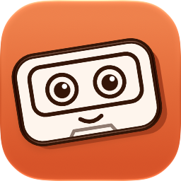
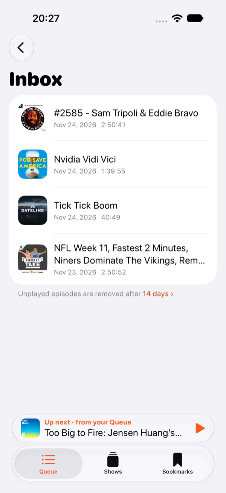
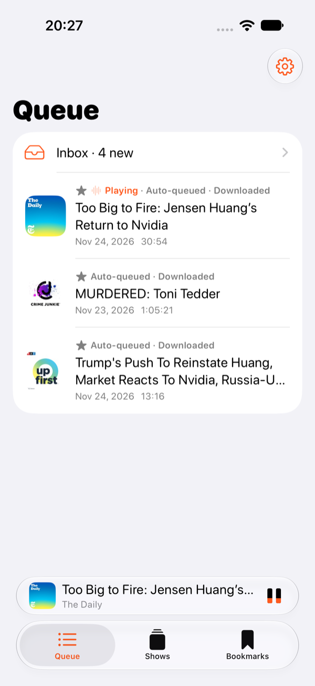
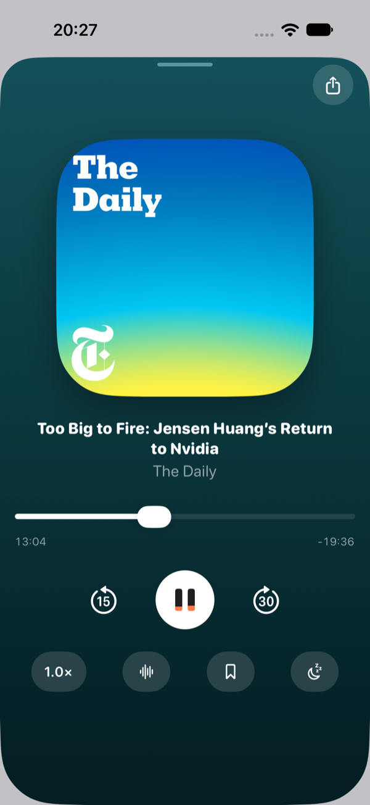

  

<h1 align="center">Casterr</h1>

  <strong>Podcasts, not homework.</strong> 
  Guilt-free, private, and open source.

  <picture>
    <source media="(prefers-color-scheme: dark)" srcset=".github/readme/inbox-dark.png">
    
  </picture>
  <picture>
    <source media="(prefers-color-scheme: dark)" srcset=".github/readme/queue-dark.png">
    
  </picture>
  <picture>
    <source media="(prefers-color-scheme: dark)" srcset=".github/readme/now-playing-dark.png">
    
  </picture>

## What it does

**Ready when you are.** Shows you love land in your Queue. The rest wait in your Inbox and quietly leave if you pass, and when Casterr spots a habit it suggests a rule you can take or leave.

**Easy on the ears.** Back a Beat, voice boost, per-show speed, chapters, and a sleep timer that can stop at the end of an episode.

**Bookmarks and notes.** Save the moments worth keeping, add a note, and send them to Obsidian, Notes, or anywhere Markdown goes.

**Yours, really.** No account, no ads, no tracking, and no server between you and your shows. The code is open, so you can check.

**Plays well with others.** Bring your shows from any app with OPML, sideload your own audio files, and share clips from shows you follow.

## Get it

Casterr is in private testing. It's coming to the App Store. Watch this repo's releases to hear first.

It runs on iPhone with iOS 27.

## Feedback

Found a bug or have an idea? [Open an issue](../../issues/new/choose).

## License

Casterr is free software under the [Mozilla Public License 2.0](LICENSE). It reads feeds with [FeedKit](https://github.com/nmdias/FeedKit), under the MIT License.
